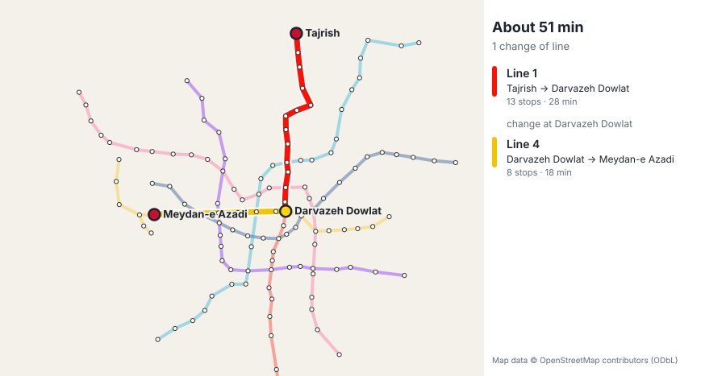

# Tehran Metro route finder

[](https://github.com/YeganehNourii/2016-tehran-metro-route-finder/actions/workflows/ci.yml)
[](https://github.com/YeganehNourii/2016-tehran-metro-route-finder/actions/workflows/pages.yml)
[](LICENSE)

A mini Google Maps for the Tehran Metro. Type two stations, in English or
Persian and with loose spelling. It tells you the fastest route and where to
change lines. The route engine is C++17 with a hand-written Dijkstra. The same
code is compiled to WebAssembly for the map demo.

**Live demo:** https://yeganehnourii.github.io/2016-tehran-metro-route-finder/ <!-- DEMO_LINK: live once GitHub Pages is enabled -->

Origin: BSc courses Advanced Programming and Discrete Mathematics (2016), rebuilt in 2026



```text
$ metro route "Tajrish" "Imam Khomeini"
"Imam Khomeini" → Emam Khomeini
From Tajrish (تجریش) to Emam Khomeini (امام خمینی(ره))

  Line 1          Tajrish → Emam Khomeini   15 stops, 32 min
                  · Gheytariyeh
                  · Shahid Sadr
                  ...
Total: about 32 min, 0 changes of line

$ metro route tajrish azadi
  Line 1          Tajrish → Darvazeh Dowlat   13 stops, 28 min
  ↳ change at Darvazeh Dowlat (+5 min)
  Line 4          Darvazeh Dowlat → Meydan-e Azadi   8 stops, 18 min
Total: about 51 min, 1 change of line
```

## How it works

1. **Data** — [`data/fetch_osm.py`](data/fetch_osm.py) asks the OpenStreetMap
   Overpass API for the metro route relations around Tehran. It keeps the
   ordered stops of each line and merges platforms with the same name into one
   station (that's what makes a transfer station). It writes
   [`data/tehran_metro.json`](data/tehran_metro.json): 134 stations with English
   and Persian names and coordinates, and 8 line segments (Lines 1–4, 6, 7 plus
   the Line 1 and Line 4 airport branches) with their official colours.
2. **Graph** — `Network` builds a weighted graph whose nodes are
   **(station, line) pairs**:
   - *ride* edges link neighbouring stations on a line. Travel time is
     estimated from the distance at 36 km/h plus a 30 s stop, because OSM has
     no timetable.
   - *transfer* edges link the lines at the same station and cost a **transfer
     penalty**: 5 min by default, adjustable.

   With plain station nodes the algorithm couldn't tell which line you are on,
   so it couldn't charge for changing.
3. **Dijkstra** ([`src/router.cpp`](src/router.cpp)), written from scratch:
   - It is multi-source: every line at the origin starts at 0.
   - It uses a binary heap (`std::priority_queue`) with lazy deletion and stops
     the first time it pops any node of the destination. O((V+E) log V).
   - The node path is collapsed into **legs** (one per line) with times, and
     the line changes between them.
4. **Fuzzy names** ([`src/fuzzy.cpp`](src/fuzzy.cpp)):
   - Names are normalised: lower case, no punctuation, and Arabic ي/ك mapped
     to Persian ی/ک.
   - They are compared with Levenshtein similarity plus a substring bonus. So
     `"Imam Khomeini"` finds *Emam Khomeini*, `azadi` finds *Meydan-e Azadi*,
     and `تجریش` finds *Tajrish*.

## Build and run

Needs CMake ≥ 3.20 and a C++17 compiler. CMake downloads nlohmann/json, used
for JSON parsing only, and Catch2 for the tests.

```bash
git clone https://github.com/YeganehNourii/2016-tehran-metro-route-finder.git
cd 2016-tehran-metro-route-finder
cmake -S . -B build
cmake --build build
ctest --test-dir build --output-on-failure

./build/metro route "Tajrish" "Imam Khomeini"
./build/metro route "Tehranpars" "Imam Khomeini Airport" --transfer 8
./build/metro route tajrish "teatr shahr" --json
./build/metro stations sadeghi
./build/metro lines
```

Exit codes: `0` ok, `1` bad usage, `2` station not found, `3` no route, `4` data error.

### Refresh the data from OpenStreetMap

```bash
python3 data/fetch_osm.py           # writes data/tehran_metro.json
python3 data/fetch_osm.py --list    # just list the route relations found
```

The script retries with backoff and falls back to mirror servers when Overpass
is busy. Re-run the tests afterwards. They check that every station can reach
every other one.

### Web demo

`.github/workflows/pages.yml` builds it on every push. To build it yourself,
with [Emscripten](https://emscripten.org) installed:

```bash
emcmake cmake -S . -B build-wasm
cmake --build build-wasm             # writes site/metro.js, site/metro.wasm, site/data/
python3 -m http.server -d site 8000  # open http://localhost:8000
```

[`web/bindings.cpp`](web/bindings.cpp) exports `mt_init`, `mt_route` and
`mt_search` as plain C functions. [`site/app.js`](site/app.js) calls them
through `cwrap`. The page draws the lines on a Leaflet map. You can click two
stations or type their names. It then draws the route, lists the steps and
"towards" directions, and lets you change the transfer penalty with a slider.

## Tests

[Catch2](https://github.com/catchorg/Catch2) unit tests, plus end-to-end CLI
checks registered with CTest:

- **Network:** JSON loading and every validation error, the graph's node and
  edge counts, and ride times from distance.
- **Dijkstra:** a hand-made network where the **transfer penalty flips the
  answer** (cheap change → switch lines; expensive change → stay on). Also the
  same station, unreachable stations, symmetry, and legs adding up. Results are
  **compared against Bellman-Ford** on 60 random pairs of real stations.
- **Fuzzy matching:** normalisation (including Persian), Levenshtein, scoring.
- **Real data:** all 134 stations are connected. Tajrish → Imam Khomeini is
  direct on Line 1. Tajrish → Azadi needs a change. The WebAssembly bridge is
  compiled natively and tested too.

GitHub Actions builds with gcc and clang on Linux and clang on macOS, with
warnings as errors, and runs everything on each push.

## Project layout

```
include/metro/   network.hpp (Station, Line, Network, Route), fuzzy.hpp, route_json.hpp
src/             network.cpp (JSON → graph), router.cpp (Dijkstra), fuzzy.cpp, route_json.cpp, main.cpp (CLI)
web/             bindings.cpp (WebAssembly exports)
site/            index.html, app.js, style.css (Leaflet demo)
data/            fetch_osm.py, tehran_metro.json
tests/           Catch2 tests, web_smoke.mjs
docs/            map.svg, render_map.py
```

## Limitations

- Travel times are estimates from straight-line distance, not the timetable.
- Line 5 (Tehran–Karaj) is tagged as a suburban train in OSM, so it is not included.
- The data is only as current as OpenStreetMap: new stations appear when OSM is
  updated and the fetch script is re-run.

## Data licence

Station and line data © [OpenStreetMap contributors](https://www.openstreetmap.org/copyright),
available under the [Open Database License (ODbL) 1.0](https://opendatacommons.org/licenses/odbl/1-0/).
`data/tehran_metro.json` is a derived database and stays under the ODbL. If you
publish changes to it, share them under the same licence and keep the
attribution. Map tiles in the demo come from openstreetmap.org.

## License

Code: [MIT](LICENSE) © 2026 Yeganeh Nouri. Data: ODbL (see above).
